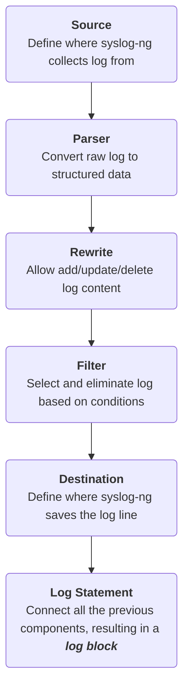
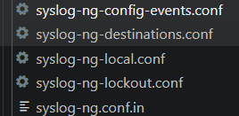
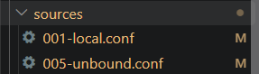

# WEEK 3 REPORT

## 1. Task
Build a new plugin used for managing log.

## 2. Analysing the task
### 2.1. Exploring OPNsense's log mechanism
#### 2.1.1. Overview of `syslog-ng`
OPNsense uses `syslog-ng` to manage log.  
`syslog-ng` is a <b>daemon</b> that receives log from multiple sources, processes these log and forward them to their designated destinations.  
In general, `syslog-ng` setup can be summarized in 6 steps below:

<b>How `syslog-ng` processes a line of log:</b>  
`syslog-ng` supports both [`RFC-5424`](#rfc-5424) and [`RFC-3164`](#rfc-3164)  
In `syslog-ng`, every line of log will be sent to all <b><i>log blocks</b></i> that matches its <b><i>source</b></i>. These blocks work concurrently and independently, pushing processed log to relative destinations if the filter matches:
```
Log from Source ──┬──> [Log block 1]: Check Filter 1 ──> (match == True) ──> Deliver to destination 1 
                  │
                  ├──> [Log block 2]: Check Filter 2 ──> (match == True) ──> Deliver to destination 2
                  │
                  └──> [Log block 3]: Check Filter 3 ──> (match == True) ──> Deliver to destination 3
```
<i>If a log line satisfies conditions of both block 1 and block 2, it will be delivered to both destination 1 and destination 2.</i>  

#### 2.1.2. How OPNsense implements `syslog-ng`
<b>An overview of `syslog-ng`'s config files:</b> 
> Config files are stored at `/core/src/opnsense/service/templates/OPNsense/Syslog`

In the `Syslog` folder, there are `.conf` files. These files contain the code that initiates and defines log blocks. There is also a `.in` file used to define the source `s_all`:  
   
```
#syslog-ng-config-events.conf

destination d_config_changed_event {
    program("/usr/local/sbin/configctl -e -t 0.5 system event config_changed");
};

filter f_config_changed_event {
    program("config") and level("info") and message(".*config-event: new_config*");
};

log {
    source(s_all);
    filter(f_config_changed_event);
    destination(d_config_changed_event);
};
```
```
#syslog-ng.conf.in

...
source s_all {
{#
    merge all source configurations
#}




};

@include "/usr/local/etc/syslog-ng.conf.d/*.conf"
```
The sources's sockets are stored at the subfolder `sources`, in the files below:  
  
These files are looped through and included in source `s_all`  
Analysing the config files give a summary of the workflow:  
```
kernel ────────► /dev/klog ──────────┐
syslog-ng ─────► internal() ─────────┤
all programs ──► /var/run/log ───────┤
(privileged) ──► /var/run/logpriv ───┼──►  s_all  ──┬─► log{local ×N}  ─► filter ─► file "audit_DATE.log" (store logs)
Unbound ───────► /var/unbound/.../log┘              ├─► log{system}    ─► filter ─► file "audit_DATE.log"
                                                    ├─► log{destinations} ─► network
                                                    ├─► log{lockout}   ─► lockout_handler (locks IP if detect too many failed attempts)
                                                    └─► log{config-events} ─► configctl
```
<b>How modules/services work with `syslog-ng` - Source code analysis:</b>   
In general, what happens is PHP first write two log messages into the socket listened by `syslog-ng`, `syslog-ng` then let the message go through its log blocks and forward the message to suitable destinations. These destinations includes: a log file (GUI will find log data here to display to users), a script that blocks failed login attempts, a chain of commands which run hooks.  
Below is an example of the workflow when an user performs a `Save` action:  
```
[0] A change is saved (GUI session or API call). Before saving, OPNsense needs to know who is making changes. GUI and API have different ways to get the context:
    ├─ GUI: 
    │    opnsense/mvc/app/library/OPNsense/Core/Config.php
    │    getRevisionContext()            :466-492  (username@IP, description)
    └─ API:
         opnsense/mvc/app/controllers/OPNsense/Base/ApiControllerBase.php
         setRevisionContext()            :332-335  (username, API key)
    │
    ▼
[1] Config::save()                       Config.php:743-776
    ├─ backup()                          Config.php:568-595   -> /conf/backup/config-<time>.xml
    ├─ auditLogChange():                 Config.php:551-562
    │     openlog("audit", ..., LOG_AUTH) :553   syslog(LOG_NOTICE, "user ... changed configuration ...") :554
    └─ new Syslog('config', null, LOG_LOCAL5)->info("config-event: new_config <file>")
          call site: Config.php:770-771
          wrapper:   opnsense/mvc/app/library/OPNsense/Core/Syslog.php
                     __construct :41-45, send() → openlog/syslog :50-51, info() :83
    │
    ▼  PHP's openlog()/syslog() write a datagram to the socket
[2] /var/run/log   (unix-dgram socket, created by syslog-ng)
    opnsense/service/templates/OPNsense/Syslog/sources/001-local.conf   :3-4
    (also sources/005-unbound.conf:1 for Unbound)
    │
    ▼
[3] syslog-ng, source s_all  (the message is parsed here: program, facility, level, message)
    opnsense/service/templates/OPNsense/Syslog/syslog-ng.conf.in
        s_all built from sources/*.conf  :16-26
        includes the generated files     :28
    +TARGETS (template → /usr/local/etc/syslog-ng.conf.d/*.conf)  :3-7
    │  (in memory: a copy goes into every log{} block)
    │
    ├────────────────────────────┬──────────────────────────┬──────────────────────────┐
    ▼                            ▼                          ▼                          ▼
[4a] AUDIT FILE             [4b] LOCKOUT             [4c] CONFIG EVENT          [4d] REMOTE (optional)
 local/audit.conf:4-6        syslog-ng-lockout.conf   syslog-ng-config-          syslog-ng-
  filter f_local_audit        :1-3 filter auth         events.conf:5-13           destinations.conf
 syslog-ng-local.conf        :13-18 program()          filter: program("config")   :24-45 network()
  :17-29 (rewrite :26,        │ stdin                  + level info + message      only if a target
  file() :18-22)              ▼                        program() → stdin            is configured
  → /var/log/audit/        scripts/syslog/             ▼
    audit_YYYYMMDD.log      lockout_handler           sbin/configctl.link
    │                       stdin :61-66               ▼
    ▼                       rules :39-48            opnsense/service/configd_ctl.py
 GUI reads it back:         pfctl :103-110            args :81-93, loop :118-146,
 actions.d/actions_                                   command string :116,
  system.conf:9,16                                    socket send :49-78 (path :47)
  ▼                                                   │ /var/run/configd.socket
 scripts/syslog/queryLog.py                           ▼
  :43-63                                            opnsense/service/modules/processhandler.py
  ▼                                                   :172 shlex.split, :256 topic, :277 section
 scripts/syslog/log_matcher.py                        ▼
  fetch_log_filenames :138-156                      opnsense/service/conf/actions.d/actions_system.conf
  ▼                                                   :85-89 [event.config_changed]
 scripts/syslog/logformats/                           ▼
  __init__.py:144-168 (pick format)                 opnsense/scripts/system/trigger_config_changed_events.py
  syslog.py:101-138 (RFC 5424 parser)                 lock :38-44, last mark :47-52, backups :54-61
                                                      runs: rc.syshook config <backup>  (:60)
                                                      ▼
                                                    etc/rc.syshook   :46-75
                                                      runs every executable in
                                                      /usr/local/etc/rc.syshook.d/config/
                                                      (this directory does not exist in core)
```

### 2.2. OPNsense's current collection of logs and Suggestions for improvements:

## 4. Appendix
### RFC-3164
---
> This standard provides a way to format and transport Syslog messages

Uses `UDP` protocol with port `514`  
Message's structure:  
```
<PRI>Mmm dd hh:mm:ss HOSTNAME TAG: CONTENT
```
The message contains 3 parts: `PRI`, `HEADER`, `MSG`
- `PRI`: `PRI` = `facility` * 8 + `severity` (read more about facility & severity values [here](#facility--severity-table))
- `HEADER`: include 2 fields  
    - TIMESTAMP: `Mmm dd hh:mm:ss` (24-hour)
    - HOSTNAME: machine's name/IPv4 address/IPv6 address of message's source (no space allowed)
- `MSG`: include 2 fields
    - TAG: program's name/process's name
    - CONTENT: details of event  

Example:
```
<34>Oct 11 22:14:15 mymachine su: 'su root' failed for lonvick on /dev/pts/8
```
<b>NOTE:</b>
This standard has no authentication mechanism, integrity-checking or encryption method. Therefore, it is vulnerable to source-spoofing, sniffing, message-tampered

### RFC-5424
---
> This standard provides a way to format and transport Syslog messages

Message's structure:  
```
<PRI>VERSION TIMESTAMP HOSTNAME APP-NAME PROCID MSGID STRUCTURED-DATA MSG
```
- `PRI`: `PRI` = `facility` * 8 + `severity` (read more about facility & severity values [here](#facility--severity-table))
- `VERSION`: Version of the standard (Currently = 1)
- `TIMESTAMP`: Follow `RFC 3339` (YYYY-MM-DDTHH:MM:SS) 
    - `T` and `Z` is uppercase
    - The decimal part of `seconds` contains a maximum of 6 digits
    - There is no second "60"
    - If originator doesn't know the time, use NILVALUE `-`
    - Originator should send timestamp. Send timezone also if possible
    - Example: `2003-10-11T22:14:15.003Z` or `2003-08-24T05:14:15.000003-07:00`
- `HOSTNAME`: Maximum 255 ASCII characters. Priority when choosing value from highest to lowest:
    - FQDN
    - IP address (static)
    - Machine's name
    - IP address (dynamic)
    - NILVALUE `-` if no information
- `APP-NAME`, `PROCID`, `MSGID`:
    - `APP-NAME`: name of device/application that generates the message (48 characters maximum)
    - `PROCID`: process ID (128 chars max)
    - `MSGID`: message ID, used to categorize events (TCPIN, TCPOUT, ID47,...)
- `STRUCTURED-DATA`: contains SD-element(s). Each element is wrapped in `[` `]`, contains `SD-ID` and data in `key`=`value` format. Some `SD-ID`s are listed below:
    - `timeQuality`: 3 parameters (`tzKnown`, `isSynced`, `syncAccuracy`)
    - `origin`: 4 parameters (`ip`, `enterpriseID`, `software`, `swVersion`)
    - `meta`: 3 parameters (`sequenceID`, `sysUpTime`, `language`)
    
- `MSG`: additional content. Allows encryption 

Example: 
```
<165>1 2003-10-11T22:14:15.003Z mymachine.example.com evntslog - ID47 [exampleSDID@32473 iut="3" eventSource="Application" eventID="1011"][examplePriority@32473 class="high"]
```
<b>NOTE:</b>
This standard has no authentication mechanism, integrity-checking or encryption method. Therefore, it is vulnerable to source-spoofing, sniffing, message-tampered

### Facility & Severity Table 
---
<b>@Facility Table</b>

| Code | Meaning | Code | Meaning |
| :--- | :--- | :--- | :--- |
| 0 | Kernel messages | 12 | NTP subsystem |
| 1 | User-level messages | 13 | Audit log |
| 2 | Mail system | 14 | Alert log |
| 3 | System daemons | 15 | Clock daemon |
| 4 | Security/authorization messages | 16 | local0 |
| 5 | Messages generated internally by syslogd | 17 | local1 |
| 6 | Line printer subsystem | 18 | local2 |
| 7 | Network news subsystem | 19 | local3 |
| 8 | UUCP subsystem | 20 | local4 |
| 9 | Clock daemon | 21 | local5 |
| 10 | Security/authorization messages (private) | 22 | local6 |
| 11 | FTP daemon | 23 | local7 |
  
  
<b>@Severity Table</b>

| Code | Level | Meaning |
| :--- | :--- | :--- |
| 0 | Emergency | System is unusable |
| 1 | Alert | Action must be taken immediately |
| 2 | Critical | Critical conditions |
| 3 | Error | Error conditions |
| 4 | Warning | Warning conditions |
| 5 | Notice | Normal but significant condition |
| 6 | Informational | Informational messages |
| 7 | Debug | Debug-level messages |
