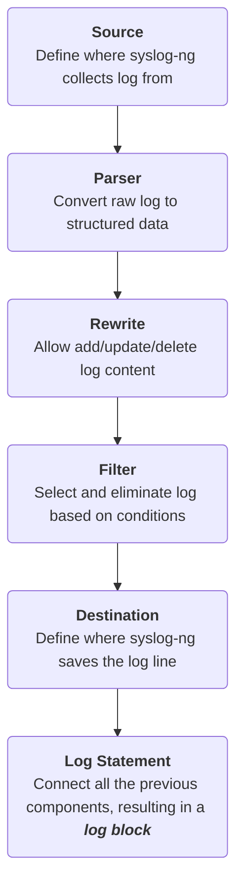

# WEEK 2 REPORT
>From 4th Oct to 10th Oct, 2026

## 1. Task
Build a new plugin used for managing log.

## 2. Analysing the task
### 2.1. Exploring OPNsense's log mechanism
#### 2.1.1. syslog-ng
OPNsense uses `syslog-ng` to manage log.  
`syslog-ng` is a <b>daemon</b> that receives log from multiple sources, processes these log and forward them to their designated destinations.  
In general, `syslog-ng` setup can be summarized in 6 steps below:

<b>How `syslog-ng` processes a line of log:</b>  
`syslog-ng` supports both [`RFC-5424`](#rfc-5424) and [`RFC-3164`](#rfc-3164)  
In `syslog-ng`, every line of log will be sent to all <b><i>log blocks</b></i> that matches its <b><i>source</b></i>. These blocks work concurrently and independently, pushing processed log to relative destinations if the filter matches:
```
Log from Source ──┬──> [Log block 1]: Check Filter 1 ──> (match == True) ──> Deliever to destination 1 
                  │
                  ├──> [Log block 2]: Check Filter 2 ──> (match == True) ──> Deliver to destination 2
                  │
                  └──> [Log block 3]: Check Filter 3 ──> (match == True) ──> Deliver to destination 3
```
<i>If a log line satisfies conditions of both block 1 and block 2, it will be delivered to both destination 1 and destination 2.</i>  

#### 2.1.2. How OPNsense implements `syslog-ng`

## 4. Appendix
### RFC-3164
Uses `UDP` protocol with port `514`  
Message's structure:  
```
<PRI>Mmm dd hh:mm:ss HOSTNAME TAG: CONTENT
```
The message contains 3 parts: `PRI`, `HEADER`, `MSG`
### RFC-5424
