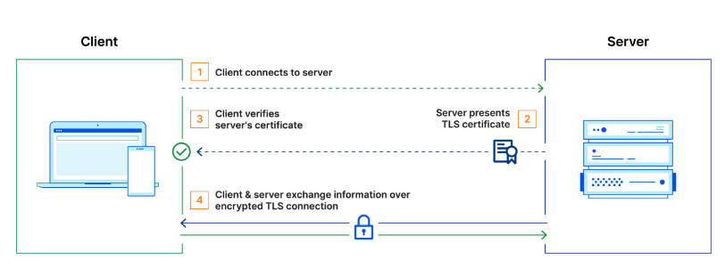
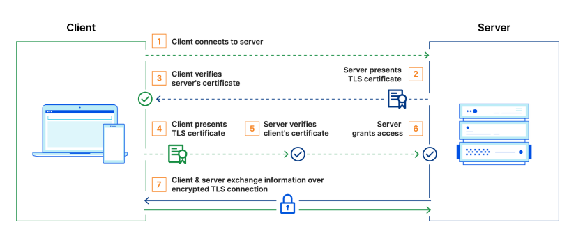
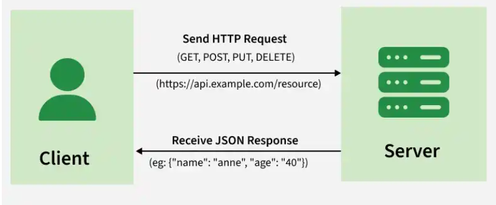

# REPORT WEEK 4
## 1. Nhiệm vụ
Tìm hiểu về certificate (chứng chỉ số) của OPNsense, module **System -> Trust -> Certificates**

<b>Viết tắt đường dẫn:</b> `MVC` = `src/opnsense/mvc/app`, `SVC` = `src/opnsense/service`, `SCR` = `src/opnsense/scripts`, `INC` = `src/etc/inc`, `WWW` = `src/www`, `JS` = `src/opnsense/www/js`.  

## 2. Phân tích
### 2.1. Chứng chỉ (certificate)
Dữ liệu gửi qua mạng có thể bị nghe lén, bị sửa giữa đường, và bị giả mạo. Mã hóa giải quyết hai rủi ro đầu. Giao thức mã hóa mà HTTPS dùng là **TLS**.

Tuy nhiên, mã hóa mà không biết đối phương là ai thì kẻ đứng giữa (MITM, man-in-the-middle) hoàn toàn có thể mở một kết nối mã hóa với client, một kết nối khác với server thật, rồi đọc và chuyển tiếp dữ liệu.   
Ví dụ:
1. Client muốn nói chuyện với server X.  
2. Client gửi yêu cầu và nhận public key từ người đang đứng giữa (MITM), không biết đó là thật hay giả.  
3. MITM tạo một cặp khóa riêng của mình: (MITM_private, MITM_public).  
4. MITM gửi MITM_public cho client.
5. Client dùng MITM_public để mã hóa dữ liệu.
6. MITM giải mã dữ liệu bằng MITM_private, đọc được nội dung, rồi mã hóa lại bằng public key thật của server X để gửi tiếp cho server.
7. Kết quả: client và server nghĩ họ đang trò chuyện trực tiếp với nhau, nhưng thực ra tất cả dữ liệu đều bị MITM đọc/đổi.  

=> Cần phải chứng minh "public key này đúng là của server X".

Giải pháp là chứng chỉ (certificate). Các chứng chỉ được cấp bởi các CA (certificate authorities). Khi 1 CA cấp chứng chỉ cho 1 website X, CA sẽ tổng hợp các thông tin như tên miền X, hạn sử dụng,.. thành 1 tệp dữ liệu `data`. Sau đó hash dữ liệu đó thành `hashed_data`. Các CA cũng có 1 bộ private key và public key. Private key dùng để kí lên hash_data để tạo chữ kí số qua 1 thuật toán mã hóa không đối xứng
```
(private key + hashed_data) -----RSA/ECDSA/other algorithms----> Chữ kí số
```
Sau đó:  
```
chữ kí số + data -----> Chứng chỉ
```
Chứng chỉ này được cấp cho X. Mỗi khi có client truy cập đến X, X sẽ gửi chứng chỉ này cho client. Client thực hiện: 
```
(public key + chữ kí số) -----thuật toán mã hóa tương ứng--------> hashed_data(chữ kí)

data ----thuật toán hash----->hashed_data(tự hash)
```
Sau đó so sánh nếu `hashed_data(chữ kí)` == `hashed_data(tự hash)` thì xác thực thành công.  

Mỗi client có một danh sách CA mà nó tin, gọi là **trust store**. OPNsense dựng trust store từ các CA khai báo ở System -> Trust -> Authorities: hàm `system_trust_configure()` ghi từng file CA (`INC/system.inc:882`) rồi gom vào `/etc/ssl/certs` (`INC/system.inc`, `SCR/system/certctl.py`).

**mTLS:**  
Tuy nhiên, OTSD cũng phải biết log và lệnh đến từ đúng thiết bị OTSA, không phải máy lạ. Vì vậy cả hai bên đều có certificate và kiểm tra nhau -> **mTLS** (mutual TLS, xác thực hai chiều). Mỗi bên cần certificate + private key của mình, và CA đã ký certificate của bên kia.

Certificate có hạn, và khóa có thể bị lộ nên cần hết hạn và thu hồi. OPNsense mặc định certificate sống 397 ngày (`MVC/models/OPNsense/Trust/Cert.xml:71-74`)
```xml
<lifetime type="IntegerField" volatile="true">
    <Required>Y</Required>
    <Default>397</Default>
</lifetime>
``` 
CA 825 ngày (`MVC/models/OPNsense/Trust/Ca.xml:57-60`). Thu hồi qua **CRL** (danh sách chứng chỉ bị thu hồi, `INC/system.inc:965-974`, `INC/plugins.inc.d/core.inc:329-331`) hoặc hỏi **OCSP** (dịch vụ trả lời trực tuyến chứng chỉ còn hợp lệ không, `MVC/library/OPNsense/Trust/Store.php:656-697`).

<b>Kết luận:</b> module Certificates là chỗ OPNsense tạo, lưu, nhập và cấp phát "căn cước" cho mọi dịch vụ dùng TLS (web GUI, VPN, syslog over TLS...).


## 3. Module Certificates
### 3.1. Tổng quát
Menu: **System -> Trust -> Certificates** (`/ui/trust/cert`).Nhóm menu là `Trust` gồm bốn trang: Authorities, Certificates, Revocation, Settings (`MVC/models/OPNsense/Core/Menu/Menu.xml:67-72`). 
1. Authorities lưu và cho phép thao tác với các CA. Có 2 cách dùng: 
* Nhập CA bên khác (VD CA của OTSD) để firewall tin các certificate do CA đó kí
* Tạo CA nội bộ để chính firewall kí certificate cho thiết bị của mình
2. Certificates dùng để thao tác với các chứng chỉ 
* Lưu chứng chi

Các dịch vụ khác (web GUI, VPN...) không giữ bản sao riêng: chúng chỉ lưu một mã tham chiếu rồi lấy cert và key từ kho này khi sinh cấu hình ([3.7](#37-certificate-tạo-xong-thì-ai-dùng)).


### 3.2. Luồng hoạt động 
Ví dụ người dùng tạo certificate nội bộ (`action = internal`):
```
[0] Người dùng bấm Add ở System -> Trust -> Certificates
    MVC/views/OPNsense/Trust/cert.volt            :31-36  (bảng và dialog gọi /api/trust/cert/*)
    │
    ▼
[1] POST /api/trust/cert/add
    MVC/controllers/OPNsense/Trust/Api/CertController.php
    addAction()                                    :215-222
    │  class cha lưu model và được kỳ vọng gọi setBaseHook() trước khi lưu 
    ▼
[2] setBaseHook($node)                             CertController.php:52-197
    ├─ refid = uniqid()                            :54-56
    ├─ kiểm tra chỉ 1 key / 1 certificate          :58-80
    ├─ case 'internal'                             :84-101
    │     Store::createCert(...)                   :84-92
    │        │   MVC/library/OPNsense/Trust/Store.php
    │        ▼
    │     _createSSLOptions()                      Store.php:191-224
    │        copy /usr/local/etc/ssl/opnsense.cnf  :196-202  (chỗ trống cho SAN, OCSP)
    │        digest, encrypt_key=false, loại key   :204-221
    │     openssl_pkey_new()  (sinh cặp khóa)      :350
    │     openssl_csr_new()   (sinh CSR)           :352
    │     ký bằng CA hoặc tự ký                    :354-355
    │        _signCert(): nạp cert+key của CA      :153-163
    │                     serial của CA +1         :164-166
    │                     openssl_csr_sign()       :169-176
    │     crt = base64(cert)                       CertController.php:94
    │     prv = base64(key), trừ khi location=local CertController.php:95-101
    └─ Cert::linkCaRefs(refid)                     CertController.php:195 -> Cert.php:59-91
    │
    ▼
[3] Lưu thành một mục <cert> mới trong config.xml  (mount /cert+, Cert.xml:2)
    Hàm ghi audit chung nằm ở MVC/library/OPNsense/Core/Config.php:557-563
    │
    ▼
[4] Phản hồi. Nếu private_key_location=local thì key nằm trong phản hồi
    CertController.php:218-220  ->  trình duyệt tải key.pem   cert.volt:209-212
```

### 3.3. Dịch vụ sử dụng certificate 
Module chỉ lưu dữ liệu. Mỗi dịch vụ tự lấy thứ nó cần:

| Dịch vụ | Cách tham chiếu | Nơi dùng key và certificate |
|---|---|---|
| Web GUI | `ssl-certref` (`INC/plugins.inc.d/webgui.inc:117`) | Ghi ra `cert.pem`, `key.pem` (`:409-417`) |
| IPsec | `certs`, `cacerts` (`MVC/models/OPNsense/IPsec/Swanctl.xml:149,208,211`) | Key vào `/usr/local/etc/swanctl/private/<refid>.key`, cert vào `.../x509/<refid>.crt` (`INC/plugins.inc.d/ipsec.inc:992-1008`) |
| OpenVPN | `cert`, `crl`, `ca` (`MVC/models/OPNsense/OpenVPN/OpenVPN.xml:185-189`) | `OpenVPN.php:174-181`, `:830-833` |
| Captive Portal | `CaptivePortal.xml:63` | `SCR/captiveportal/generate_certs.php:38` |
| Syslog over TLS | `Syslog.xml:89` | `SCR/syslog/generate_certs.php:39-47` |
| Wi-Fi WPA-EAP | `Wlan.xml:164,167` | `INC/interfaces.inc:1898` |
| Trust store hệ thống | danh sách CA ở Authorities | `system_trust_configure()` (`INC/system.inc:882-998`) |

Việc "không cho xóa nếu đang dùng" có ở cả code cũ (`cert_in_use()`, `INC/certs.inc:281-290`) và code mới (`CertificatesField.php:188-203`, `CertController.php:233`).

## 4. Appendix
### TLS, mTLS. HTTPS
---
**TLS và mTLS:**
Thông thường trong TLS, chỉ có server sở hữu TLS certtificate và 1 cặp (public key, private key). Quy trình đặc trưng của TLS như sau:  


Trong mTLS thì cả client và server đều sở hữu certificate và 2 bên đều xác thực với cặp key của mình. So với TLS thông thường, mTLS có thêm các bước 4,5,6 như sơ đồ dưới đây:  


Trong mTLS thì CA là CA nội bộ (root CA), bên implement mTLS sẽ trở thành CA của chính họ luôn (tự kí chứng chỉ và cấp cho SA/SD, sau đó SA/SD kiểm tra chứng chỉ bằng public key của CA nội bộ)  

**HTTPS là HTTP chạy trong TLS**
### REST API
Là cách thiết kế API tuân thủ những yêu cầu dưới đây:  
1. Sử dụng kiến trúc client-server để phân biệt user interface và server-side processing
2. Cho phép truy cập tài nguyên (dữ liệu/chức năng/...) qua các URls riêng biệt
3. Sử dụng các phương thức HTTP để làm việc với tài nguyên


### Wazuh
---

> Là nền tảng giám sát an ninh mã nguồn mở, gồm agent chạy trên máy được giám sát và ba thành phần trung tâm: server, indexer, dashboard.

| Thành phần | Vai trò | Cổng mặc định |
|---|---|---|
| Agent | Chạy trên thiết bị, liên tục gửi sự kiện về server (W1) | Kết nối ra cổng 1514 |
| Server | Phân tích sự kiện. Chạy dịch vụ nhận kết nối agent, dịch vụ đăng ký (enrollment) agent và RESTful API (W1) | 1514 (kết nối agent, chỉnh được), 1515 (enrollment), 55000 (API) |
| Indexer | Lưu và lập chỉ mục cảnh báo, sự kiện (W1). Số cổng không có trong đoạn tài liệu mình đọc | chưa có |
| Dashboard | Giao diện hiển thị; gọi API server ở cổng 55000 (W1) | n/a |

```
agent ──(1514)──► Wazuh server ──(Filebeat, TLS)──► Wazuh indexer ◄── Wazuh dashboard
  └─(1515 enrollment)─►  │                                                   │
                         └◄────────── server RESTful API (55000) ◄───────────┘
```
Server đẩy dữ liệu sang indexer bằng Filebeat có mã hóa TLS.

### Fluent Bit
---

>Là Chương trình thu thập và chuyển tiếp log: plugin input lấy dữ liệu, plugin output gửi đi. Cả input và output có truy cập mạng đều bật được TLS.

<b>Các tùy chọn TLS</b>:

| Tùy chọn | Ý nghĩa |
|---|---|
| `tls`, `tls.verify`, `tls.verify_hostname` | Bật TLS; bắt buộc kiểm tra certificate; kiểm tra tên host |
| `tls.ca_file`, `tls.ca_path` | File hoặc thư mục CA dùng để xác minh bên kia |
| `tls.crt_file`, `tls.key_file`, `tls.key_passwd` | Certificate, private key và mật khẩu key (tùy chọn). Ở output đây chính là certificate client cho mTLS |
| `tls.min_version`, `tls.max_version` | Phiên bản TLS tối thiểu và tối đa |
| `tls.ciphers`, `tls.vhost` | Danh sách cipher (chỉ "tới TLSv1.2"); tên host cho SNI |
| `tls.verify_client_cert` | Phía input: bắt buộc và kiểm tra certificate client kết nối tới (F1) |

<b>Plugin output `opensearch` (F2).</b> Đẩy bản ghi vào OpenSearch. Có các tham số `Host`, `Port` (ví dụ dùng 9200), `HTTP_User`, `HTTP_Passwd`, `Suppress_Type_Name`; hỗ trợ TLS với các tùy chọn trên. Với Amazon OpenSearch Service chạy OpenSearch 2.0 trở lên, tài liệu yêu cầu `Suppress_Type_Name On`.

<b>Ví dụ output mTLS</b> ghép từ tên tùy chọn có trong tài liệu (giá trị chỉ là chỗ giữ chỗ, chưa thử; một pull request mẫu có `tls.min_version TLSv1.3` cùng file CA, key, certificate, F6):
```
[OUTPUT]
    Name             opensearch
    Match            *
    Host             <địa-chỉ-otsd>
    Port             9200
    tls              On
    tls.verify       On
    tls.min_version  TLSv1.3
    tls.ca_file      /path/to/ca.crt
    tls.crt_file     /path/to/otsa-client.crt
    tls.key_file     /path/to/otsa-client.key
```

<b>Hàng đợi khi mất kết nối</b>  
* Mặc định Fluent Bit buffer trong RAM (`storage.type memory`). Khi vượt `Mem_Buf_Limit` thì input bị tạm dừng và bản ghi mới có thể bị mất.  
* Đặt `storage.type filesystem` ở input cùng `storage.path` ở phần service thì dữ liệu được giữ trên đĩa. Tài liệu khuyên dùng filesystem buffering để bảo đảm an toàn dữ liệu.  
* Phần chưa gửi được trước khi tắt vẫn nằm trên đĩa (backlog) và được nhặt lại khi khởi động (`storage.backlog.mem_limit`). `storage.total_limit_size` (từ v1.6) giới hạn dung lượng đĩa cho mỗi output; đầy thì bản ghi cũ nhất bị bỏ. Output có `retry_limit` cho lần gửi lỗi (F5 ví dụ dùng 15).  

<b>Cần gì từ module certificate [U]:</b> CA đã ký certificate của OpenSearch (cho `tls.ca_file`); certificate và key client nếu phía nhận bắt mTLS (chưa biết indexer của OTSD có bắt không); việc xuất file có thể theo mẫu syslog: `Store::getCertificate` rồi ghi file quyền 0640 (`SCR/syslog/generate_certs.php:39-47`).

### OpenSearch
---
> OpenSearch là engine tìm kiếm và lưu trữ nhận log; plugin `opensearch` của Fluent Bit gọi REST API của nó


